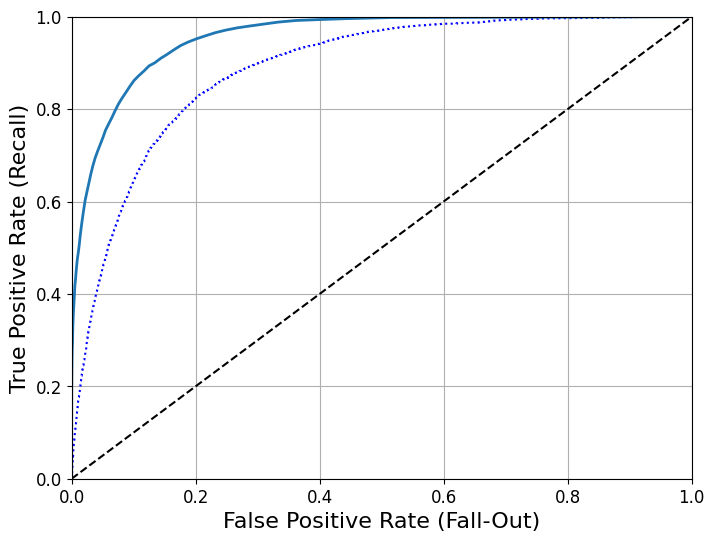
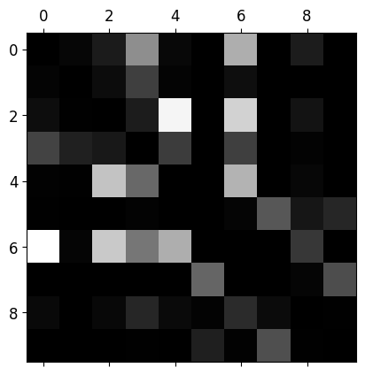

# Fashion-MNIST Image Classification

**Python · scikit-learn · TensorFlow/Keras · Classification · Error analysis**

How can a model distinguish clothing categories from small grayscale images? This project explores binary and multiclass classification on Fashion-MNIST, including model evaluation and analysis of misclassified items.

**Project type:** Machine-learning course assignment  
**Notebook:** [Original classification analysis](notebooks/fashion_classification_original.ipynb)

## Dataset

Fashion-MNIST contains **60,000 training images and 10,000 test images**, with 10 clothing categories. Each image is 28 × 28 pixels in grayscale. The notebook loads the dataset through TensorFlow/Keras.

## What I explored

- A binary classifier to distinguish shirts from other clothing.
- Precision, recall, ROC curves, and comparisons between classifiers.
- Multiclass clothing classification, confusion matrices, and misclassification analysis.
- A random forest evaluated using cross-validation and the separate test set.

## Results from the saved notebook

| Analysis | Saved result | Evaluation |
|---|---:|---|
| Random forest: 10 clothing classes | **87.64% accuracy** | Held-out test set |
| Random forest: 10 clothing classes | **88.02% mean accuracy** | Three-fold cross-validation |
| Random forest: shirt vs. non-shirt | **0.956 ROC AUC** | Cross-validated predictions |
| SGD: shirt vs. non-shirt | **0.887 ROC AUC** | Cross-validated predictions |

The test accuracy and multiclass cross-validation scores describe the 10-class task. The AUC scores describe the separate binary task and are not directly comparable to multiclass accuracy.

These figures come from saved notebook outputs and have not been independently reproduced. The multiclass notebook scales the training data before cross-validation; preprocessing should be moved inside each fold in a future rerun.

## Visual analysis

*Original notebook visualization comparing ROC curves for the binary classification task.*

*Original normalized multiclass confusion visualization with the diagonal removed, highlighting misclassifications.*

## Related notebook experiments

- [Fashion-MNIST with MLP](https://github.com/HIRAL13CHOKSI/BIG-DATA-ANALYTICS-PROJECTS/blob/main/Fashion-MNIST%20with%20MLP.ipynb)
- [Fashion-MNIST with convolutional networks](https://github.com/HIRAL13CHOKSI/BIG-DATA-ANALYTICS-PROJECTS/blob/main/Fashion-MNIST%20with%20Convnets.ipynb)

These experiments are linked from the original collection; their results still need an independent review before comparison.

## Reproducing the analysis

Open the [original notebook](notebooks/fashion_classification_original.ipynb) in Jupyter or Colab. It uses Python, TensorFlow/Keras, NumPy, matplotlib, and scikit-learn. The notebook downloads Fashion-MNIST through Keras. Exact package versions and a clean rerun remain to be verified.

**Skills:** image data exploration · classification · cross-validation · ROC analysis · confusion matrices · model comparison
